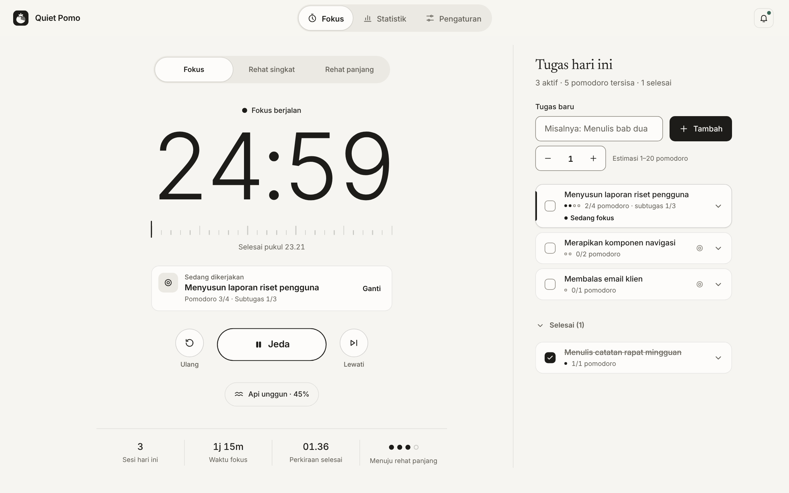
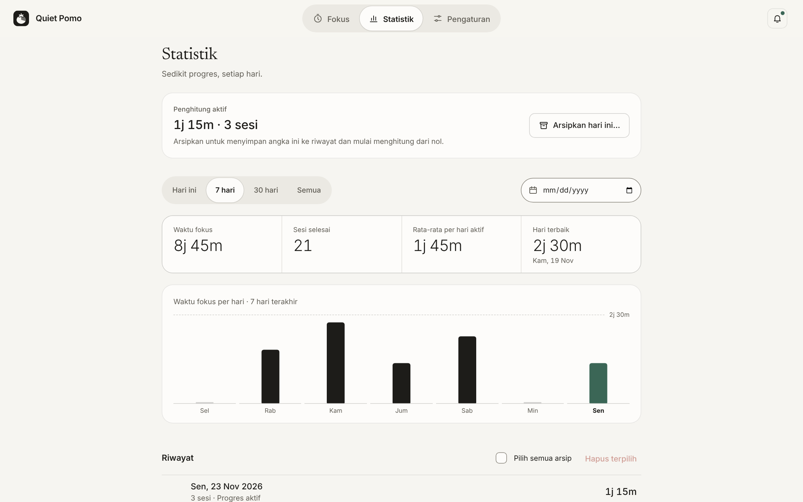
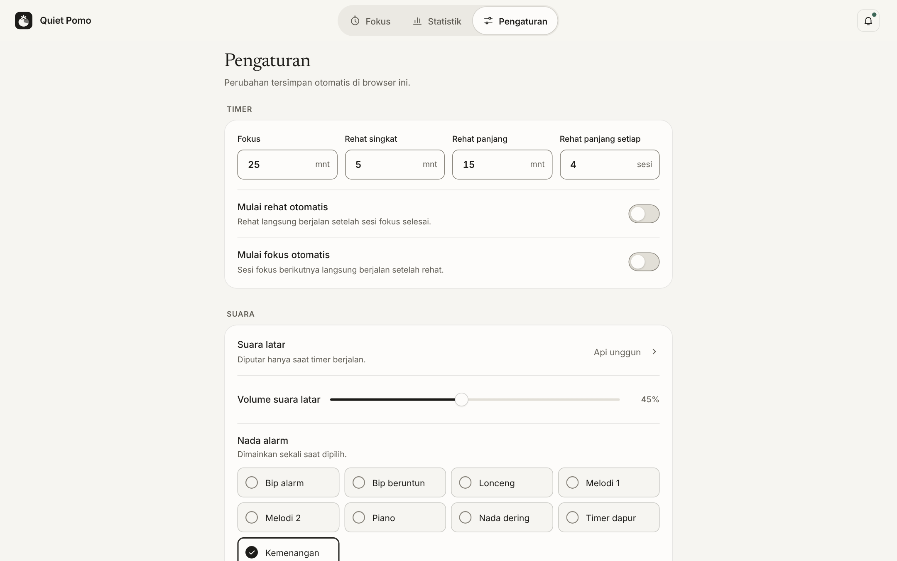
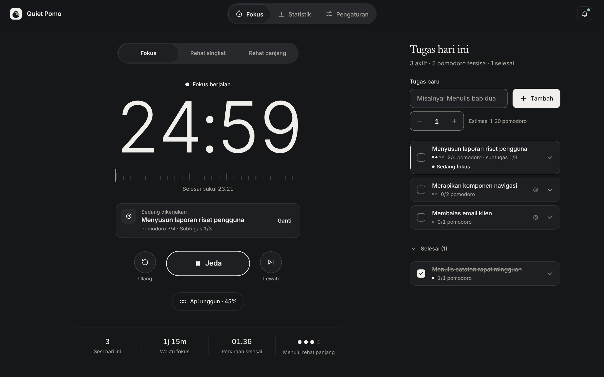
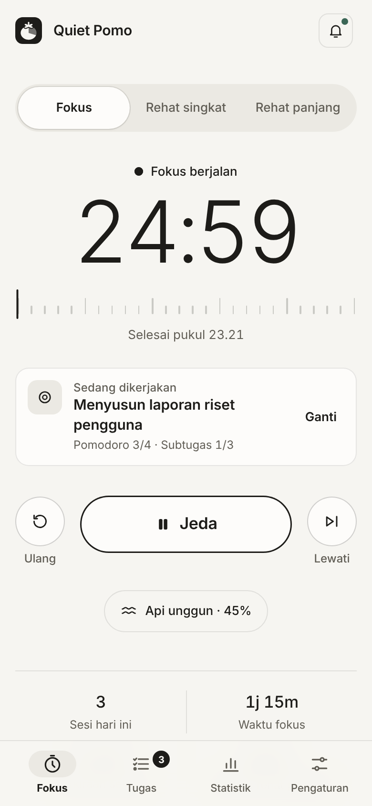
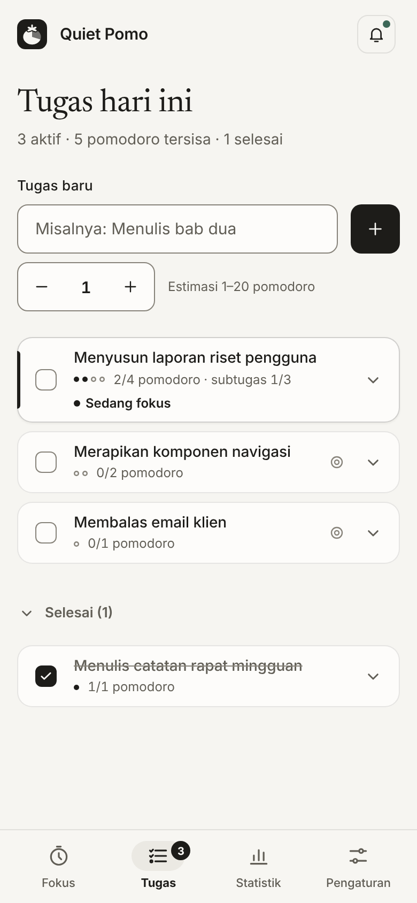
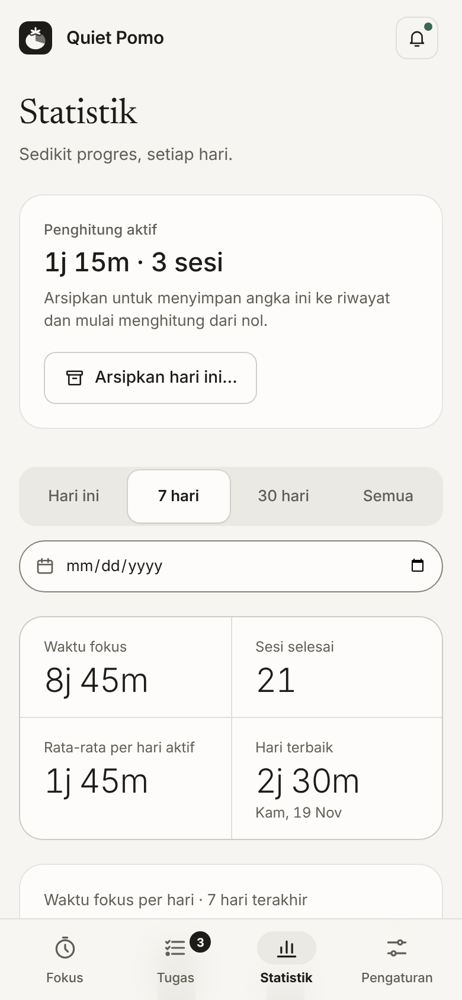
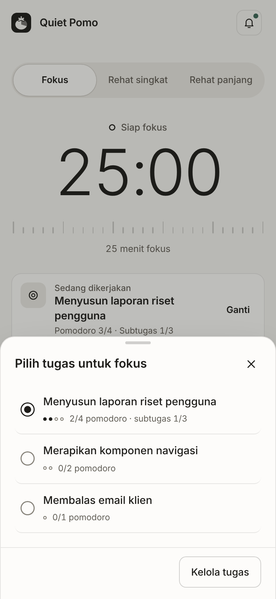
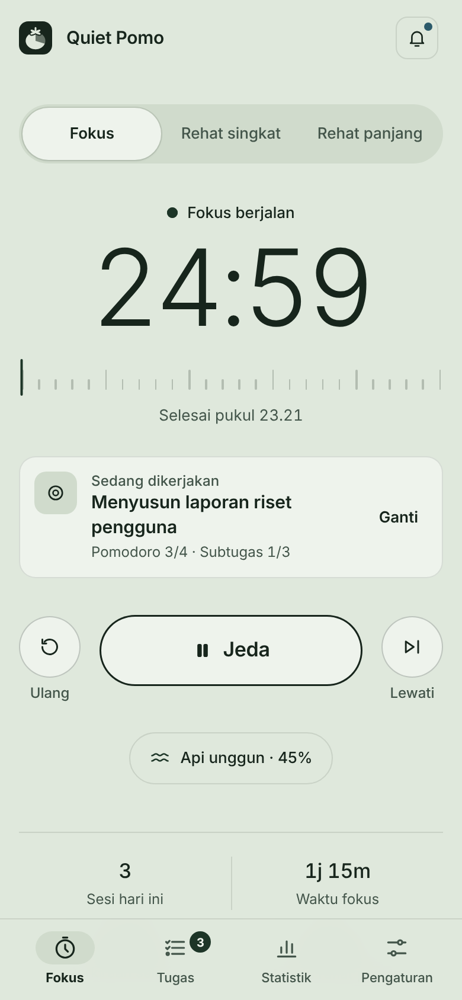

<p align="center"></p>

<h1 align="center">Quiet Pomo</h1>

<p align="center">
  Ruang tenang untuk mengerjakan satu hal pada satu waktu.<br />
  Timer Pomodoro, daftar tugas, statistik fokus, suara latar, dan tema pribadi dalam satu aplikasi web ringan.
</p>

<p align="center">
  <a href="https://andikapramudya-project.github.io/Quite-Pomo/"><strong>Buka aplikasi</strong></a> ·
  <a href="#tampilan">Tampilan</a> ·
  <a href="#fitur">Fitur</a> ·
  <a href="#cara-pakai">Cara pakai</a> ·
  <a href="#menjalankan-secara-lokal">Menjalankan</a> ·
  <a href="#pengujian">Pengujian</a>
</p>

<p align="center">
  
  
  
  
</p>

---

## Ringkasan

Quiet Pomo adalah aplikasi Pomodoro berbasis web yang dirancang untuk fokus tanpa gangguan. Aplikasi ini tidak memerlukan akun, tidak memiliki server, dan tidak mengumpulkan data. Semua tugas, pengaturan, dan riwayat fokus tersimpan di browser kamu sendiri.

Arah desainnya disebut **Quiet Desk**: timer dan pekerjaan yang sedang aktif berada di tengah, sedangkan alat pendukung seperti statistik dan pengaturan tersimpan rapi dan mudah dijangkau. Detail desain, design tokens, dan bahasa animasi ada di [DESIGN.md](DESIGN.md).

> Repositori ini bernama **Quite-Pomo**, sedangkan nama aplikasinya **Quiet Pomo**. Keduanya merujuk ke proyek yang sama.

## Tampilan

### Laptop

<p align="center">
  
</p>

<p align="center"><em>Fokus: timer di kiri dan daftar tugas yang selalu terlihat di kanan.</em></p>

<table>
  <tr>
    <td width="50%"></td>
    <td width="50%"></td>
  </tr>
  <tr>
    <td align="center"><em>Statistik: metrik, grafik harian, dan riwayat</em></td>
    <td align="center"><em>Pengaturan: timer, suara, notifikasi, dan tampilan</em></td>
  </tr>
  <tr>
    <td colspan="2"></td>
  </tr>
  <tr>
    <td colspan="2" align="center"><em>Tema Ink untuk ruangan redup</em></td>
  </tr>
</table>

### Ponsel

<table>
  <tr>
    <td width="33%"></td>
    <td width="33%"></td>
    <td width="33%"></td>
  </tr>
  <tr>
    <td align="center"><em>Fokus</em></td>
    <td align="center"><em>Tugas</em></td>
    <td align="center"><em>Statistik</em></td>
  </tr>
  <tr>
    <td></td>
    <td></td>
    <td></td>
  </tr>
  <tr>
    <td align="center"><em>Pilih tugas tanpa meninggalkan timer</em></td>
    <td align="center"><em>Tema Sage</em></td>
    <td></td>
  </tr>
</table>

## Fitur

### Timer

- Tiga mode: **Fokus**, **Rehat singkat**, dan **Rehat panjang**. Bawaannya 25, 5, dan 15 menit, dengan rehat panjang setiap 4 sesi. Semua durasi bisa diatur.
- Status timer mudah dibaca dari jauh. Siap, berjalan, dijeda, dan selesai masing-masing punya label dan penanda bentuk, jadi tidak hanya mengandalkan warna.
- **Penggaris menit** menunjukkan progres sesi dan perkiraan jam selesai ("Selesai pukul 15.20").
- Pilihan untuk memulai rehat atau sesi fokus berikutnya secara otomatis.
- Hitungan berbasis timestamp dan berjalan di **Web Worker**, sehingga tetap akurat ketika tab berada di latar belakang.
- Konfirmasi sebelum berpindah mode saat sesi fokus sedang berjalan, supaya progres tidak hilang karena salah tekan.

### Tugas

- Tambah tugas dengan **estimasi pomodoro** (1–20).
- **Subtugas** untuk memecah pekerjaan besar.
- Pilih satu tugas untuk difokuskan. Tugas itu tampil di timer bersama progres pomodoro dan subtugasnya.
- Progres pomodoro bertambah otomatis setiap kali sesi fokus selesai. Mencentang selesai secara manual tidak menambah statistik.
- Tugas yang selesai dikelompokkan terpisah dan bisa dilipat.
- Hapus tugas bisa **diurungkan** lewat notifikasi singkat.

### Statistik dan riwayat

- Periode **Hari ini, 7 hari, 30 hari, Semua**, serta filter tanggal tertentu.
- Empat metrik: waktu fokus, jumlah sesi, rata-rata per hari aktif, dan hari terbaik.
- Grafik batang harian dengan garis skala maksimum.
- **Arsipkan hari ini** untuk menyimpan progres ke riwayat dan memulai hitungan baru. Pergantian hari diarsipkan otomatis.
- Riwayat bisa dipilih lalu dihapus sebagian.
- **Ekspor dan impor cadangan** dalam format JSON. Cadangan versi 1–3 tetap bisa dibaca, dan impor tidak membuat data ganda.

### Suara dan notifikasi

- **Suara latar**: kedai kopi, hujan, tepi pantai, aliran sungai, perpustakaan, api unggun, angin di pepohonan, angin dan jangkrik, serta detak jam. Volumenya bisa diatur dan suara bisa diganti cepat dari layar timer.
- **Sembilan nada alarm**, dan setiap nada diputar sekali saat dipilih sebagai pratinjau.
- **Notifikasi browser** dengan pesan yang bisa diubah sendiri. Statusnya selalu jelas: aktif, belum aktif, diblokir, tidak didukung, atau membutuhkan HTTPS.

### Tampilan dan aksesibilitas

- Tiga tema yang diracik manual: **Paper**, **Sage**, dan **Ink**. Kamu juga bisa membuat palet sendiri, dan kontrasnya disesuaikan otomatis agar teks tetap terbaca.
- Layout responsif dari 320 px hingga layar lebar, tanpa scroll ke samping.
- Navigasi keyboard penuh, fokus yang kembali ke tombol asal setelah dialog ditutup, dan area sentuh minimal 44 px.
- Tetap nyaman dipakai dengan ukuran teks 200% dan menghormati pengaturan **kurangi gerakan** (*reduced motion*) dari sistem.
- Bisa **dipasang di layar utama** ponsel atau laptop seperti aplikasi biasa.

## Cara pakai

1. Tulis tugas di **Tugas baru**, atur estimasinya, lalu tekan **Tambah**.
2. Pilih tugas untuk difokuskan. Di laptop cukup klik tugasnya. Di ponsel, ketuk **Ganti** pada kartu "Sedang dikerjakan".
3. Tekan **Mulai** atau tombol **Spasi**. Setelah sesi fokus selesai, rehat dimulai dan progres tugas bertambah.
4. Pantau perkembangan di **Statistik**, dan ekspor cadangan secara berkala.

| Perangkat | Navigasi |
| --- | --- |
| Laptop dan desktop (≥ 1024 px) | Timer dan daftar tugas tampil berdampingan. **Statistik** dan **Pengaturan** ada di navigasi atas. Saat kamu membuka halaman lain, mini-timer di header tetap menampilkan waktu beserta tombol jeda. |
| Tablet dan ponsel | Navigasi bawah berisi **Fokus · Tugas · Statistik · Pengaturan**. Ganti tugas dan suara latar dibuka sebagai panel dari bawah, tanpa meninggalkan timer. |

| Pintasan | Fungsi |
| --- | --- |
| <kbd>Spasi</kbd> | Mulai atau jeda timer, saat kursor tidak berada di kolom isian |
| <kbd>Esc</kbd> | Tutup dialog atau panel |
| <kbd>←</kbd> <kbd>→</kbd> <kbd>Home</kbd> <kbd>End</kbd> | Pindah mode timer ketika pilihan mode sedang difokuskan |

### Memasang sebagai aplikasi

- **Android (Chrome):** buka menu ⋮, lalu pilih **Tambahkan ke layar utama** atau **Instal aplikasi**.
- **iPhone dan iPad (Safari):** ketuk **Bagikan**, lalu pilih **Tambahkan ke Layar Utama**.
- **Laptop (Chrome atau Edge):** klik ikon instal di kolom alamat.

Notifikasi hanya bisa diaktifkan saat aplikasi dibuka lewat HTTPS (misalnya GitHub Pages) atau `localhost`.

## Menjalankan secara lokal

Aplikasi ini tidak memerlukan build atau dependensi. Cukup sajikan foldernya melalui server HTTP statis:

```sh
git clone https://github.com/andikapramudya-project/Quite-Pomo.git
cd Quite-Pomo
python -m http.server 8080
```

Lalu buka `http://localhost:8080`.

### Publikasi ke GitHub Pages

Buka **Settings → Pages** di repositori, pilih **Deploy from a branch**, lalu pilih branch `main` dengan folder `/ (root)`. Semua path di aplikasi bersifat relatif, sehingga aplikasi langsung berjalan di `https://<username>.github.io/Quite-Pomo/`.

## Struktur proyek

```text
index.html             Struktur antarmuka: view Fokus, Tugas, Statistik, Pengaturan, sheet, dan dialog
styles.css             Design tokens, tema, layout responsif, dan animasi
app.js                 Logika aplikasi (timer, tugas, audio, notifikasi, impor/ekspor) dan render tampilan
motion.js              Helper animasi dengan dukungan reduced motion
focus-data.js          Fungsi data: riwayat, arsip, pergantian hari, ekspor/impor
timer-worker.js        Detak timer di Web Worker
manifest.webmanifest   Manifest agar aplikasi bisa dipasang
assets/                Logo, ikon aplikasi, suara latar, dan nada alarm
docs/screenshots/      Screenshot dokumentasi
tests/                 Pengujian data dan pemeriksaan browser
DESIGN.md              Arah desain, tokens, dan bahasa animasi
```

## Pengujian

Pengujian data dan timer memakai test runner bawaan Node.js:

```sh
npm test
```

Pemeriksaan browser memakai Playwright. Jalankan server terlebih dahulu di `http://127.0.0.1:5173`:

```sh
python -m http.server 5173 --bind 127.0.0.1
node tests/browser-smoke.mjs        # arsip dan reset, persistensi, filter, tema, migrasi data lama, ekspor, tengah malam
node tests/task-timer-import.mjs    # rehat, tugas dan subtugas, impor v2/v3, penjadwalan alarm, Worker
node tests/header-icons.mjs         # ikon header dan alur izin notifikasi
node tests/design-review.mjs        # 5 lebar layar × 3 tema, area sentuh, kontras palet, teks 200%, keyboard, animasi
```

Tambahkan `PLAYWRIGHT_CHANNEL=chromium` bila Chrome tidak terpasang. Argumen pertama boleh berisi path ke `playwright/index.mjs`.

## Data dan privasi

- Semua data disimpan di `localStorage` browser dengan kunci `quiet-pomo-state-v1` dan tidak pernah dikirim ke server mana pun.
- Menghapus data situs atau memakai mode penyamaran akan menghapus data tersebut. Gunakan **Ekspor** di halaman Statistik untuk membuat cadangan.
- Halaman memuat font Inter dan Newsreader dari Google Fonts. Tanpa koneksi internet, font sistem dipakai sebagai gantinya.

## Batasan yang diketahui

- Browser bisa membekukan tab yang lama tidak aktif, dan timer ikut berhenti saat komputer atau ponsel tidur. Untuk sesi penting, biarkan tab tetap terbuka dan layar menyala.
- Data tidak tersinkron antarperangkat. Pindahkan data dengan fitur ekspor dan impor.
